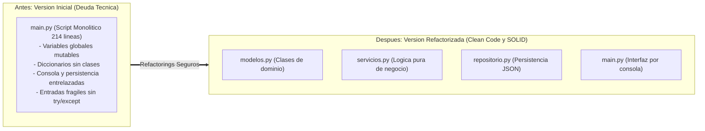
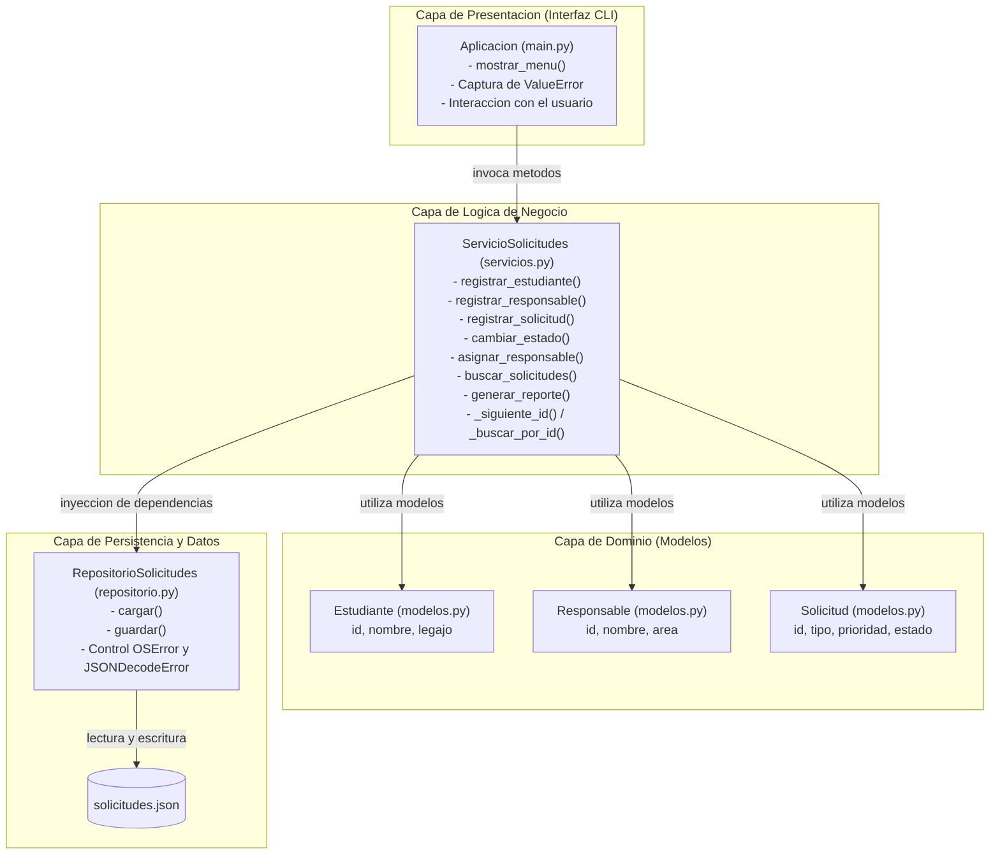

# Diagrama de Arquitectura y Clases del Sistema
## Metodologia de Sistemas II - Trabajo Practico Integrador

En este documento presentamos los diagramas tecnicos que evidencian la evolucion profesional del sistema, mostrando primero la transformacion estructural antes y despues del refactoring, y luego el detalle de la arquitectura por capas resultante.

---

### 1. Comparacion Estructural: Antes vs Despues

Muestra la transicion general desde el script monolitico inicial con deuda tecnica hacia la estructura modular desacoplada:

---

### 2. Diagrama de Arquitectura por Capas (Version Refactorizada)

Detalla la interaccion interna, la distribucion de responsabilidades y la inyeccion de dependencias en el sistema mejorado:

---

### 3. Explicacion de las Decisiones de Diseño

1. **Principio de Responsabilidad Unica (SRP):** Cada clase tiene una sola razon para cambiar. Si cambia el almacenamiento, solo se modifica `repositorio.py`. Si cambia la interfaz de consola, solo se modifica `main.py`. Si cambian las reglas de aprobacion o estados, solo se modifica `servicios.py`.
2. **Principio de Inversion de Dependencias (DIP):** `ServicioSolicitudes` recibe su repositorio mediante su constructor `__init__`, evitando acoplamiento rigido con archivos fisicos de disco.
3. **Manejo Estructurado de Excepciones:** La logica de negocio lanza excepciones semanticas (`ValueError`) y la capa de interfaz las atrapa amigablemente sin reiniciar ni colapsar el programa.
